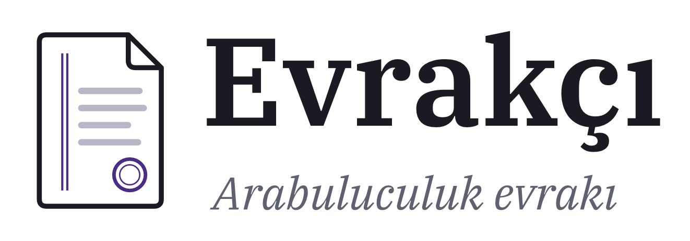
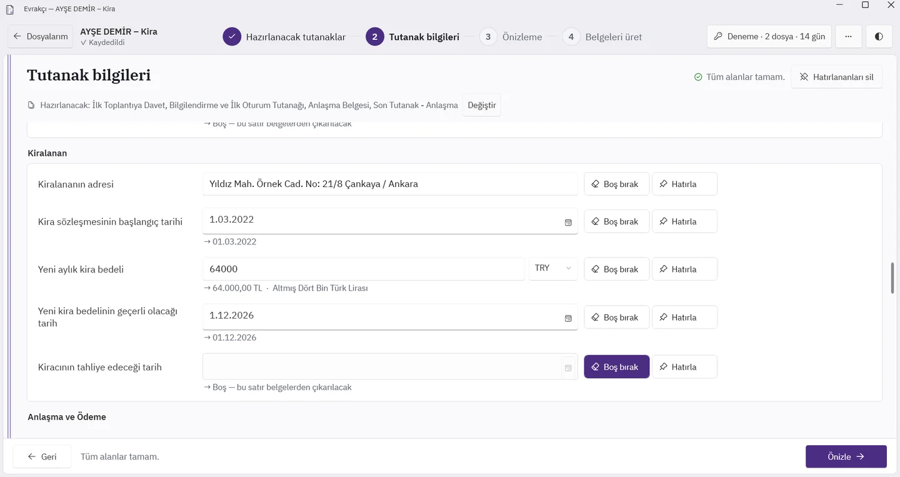
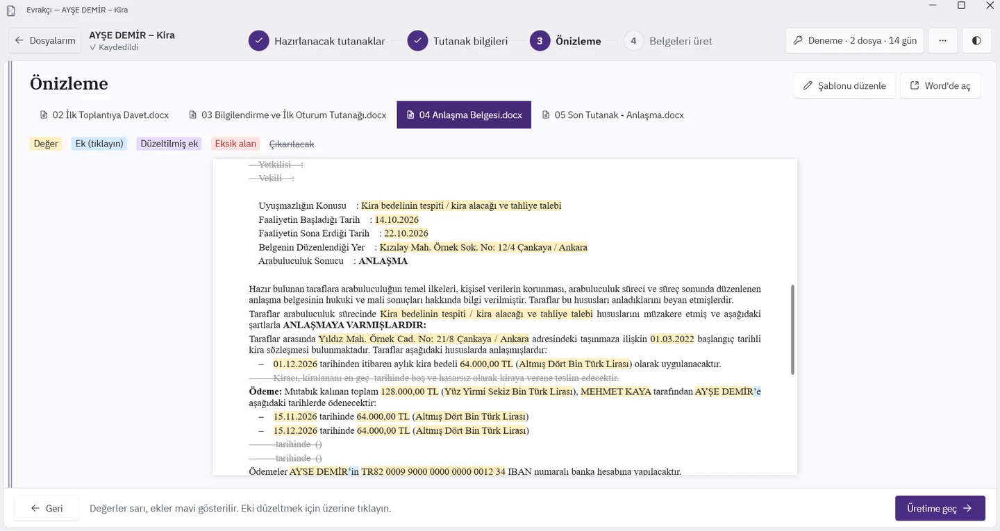

<p align="center">
  
</p>

<p align="center">
  <b>Arabuluculuk dosyasının bütün evrakı, tek formdan.</b><br>
  Ücretsiz ve açık kaynak Windows uygulaması · Word (.docx) ve UYAP (.udf) çıktısı
</p>

<p align="center">
  <a href="https://github.com/cahitarslan/evrakci/releases/latest"></a>
  <a href="LICENSE"></a>
  
  
  <a href="https://github.com/cahitarslan/evrakci/actions/workflows/ci.yml"></a>
</p>

Evrakçı, arabulucuların her dosyada yeniden yazdığı belgeleri (arabulucu belirleme tutanağı, ilk toplantıya davet, bilgilendirme ve ilk oturum tutanağı, anlaşma belgesi, son tutanaklar) tek bir formdan doldurur. Tarafları, tutarları ve tarihleri bir kez yazarsınız; Evrakçı Türkçe ekleri değere göre düzeltir, tutarları yazıyla yazar, TCKN ve IBAN'ı denetler, belgeleri Word ve UYAP biçiminde kaydeder.

Belgeler internetsiz üretilir. Müvekkil bilgileri bilgisayardan çıkmaz, telemetri yoktur. İnternete yalnızca yeni sürüm olup olmadığını sormak için çıkılır.

<p align="center">
  
  
</p>

## İndir

- **Kurulum:** [Son sürümün](https://github.com/cahitarslan/evrakci/releases/latest) `Evrakci-win-Setup.exe` dosyası (ya da [evrakci.netlify.app](https://evrakci.netlify.app)). Yönetici izni istemez, `%LocalAppData%\Evrakci` altına kurulur ve kendiliğinden güncellenir.
- **Taşınabilir:** Aynı sayfadaki `Evrakci-win-Portable.zip` kurulum gerektirmez.
- Kurulum dosyası henüz kod imzalı değildir; Windows SmartScreen "tanınmayan uygulama" uyarısı verebilir (**Ek bilgi → Yine de çalıştır**). İsterseniz kaynak koddan kendiniz derleyebilirsiniz (bkz. *Geliştirme*).

## Neler yapar

- **9 arabuluculuk türü için hazır setler:** işçi–işveren, ticari, tüketici, kira, ortaklığın giderilmesi, kat mülkiyeti, komşu hakkı, tarımsal üretim sözleşmesi ve ihtiyari arabuluculuk.
- **Türkçe ek uyumu:** şablonda `{{{AD}}}'nın` yazılan yer değere göre *KAYA'nın*, *YILMAZ'ın*, *2026'da* olur.
- **Tutarlar yazıyla:** 64.000,00 TL → *Altmış Dört Bin Türk Lirası*. Taksitlerin toplamı anlaşma tutarını tutmazsa belge üretilmez.
- **Denetimler:** TCKN, IBAN, telefon ve tarih sırası girilirken kontrol edilir.
- **Şablon düzenleyici:** Word gerektirmeden metni değiştirin, seçtiğiniz metni tek tıkla değişkene çevirin, kendi setlerinizi kurun.
- **Word ve UYAP:** Aynı şablondan `.docx` ve `.udf` çıktısı.
- **Gizlilik:** Dosyalar Windows kullanıcısına bağlı olarak şifreli saklanır; başka bilgisayara şifreli `.evrak` dosyasıyla taşınır.

## Kullanım

Uygulama **Dosyalarım** ekranıyla açılır. Her arabuluculuk dosyası (ör. "AYŞE YILMAZ – Kira") burada listelenir; bir dosyaya tıklayınca kaldığınız yerden devam edilir.

1. **Yeni dosya:** Dosyanın türünü seçin (İşçi – İşveren, Kira, Ticari …).
2. **Hazırlanacak tutanaklar:** Bu dosyada üretilecek tutanaklar işaretlenir (ör. anlaşma yoksa "Son Tutanak - Anlaşamama"). Her tutanağın yanındaki **Şablonu düzenle** ile metin bu adımda da düzeltilebilir.
3. **Tutanak bilgileri:** Form yalnızca seçilen tutanakların alanlarını sorar. Değerler girilirken doğrulanır; alanın altında belgeye nasıl yazılacağı görünür (ör. `→ 64.000,00 TL · Altmış Dört Bin Türk Lirası`). Satırın sonundaki silgi simgesi alanı **boş bırakır**, iğne simgesi değeri **hatırlar** (arabulucunun adı, sicil numarası, IBAN'ı gibi; aynı adlı alanın geçtiği bütün setlerde yeni dosyaya kendiliğinden yazılır). Şablona değişken eklenir ya da çıkarılırsa form hemen güncellenir (Word'de kaydedilen değişiklikler de uygulamaya dönünce okunur).
4. **Önizleme:** Değerler sarı, Türkçe ekler mavi gösterilir. Bir eke tıklayarak elle düzeltebilirsiniz. Belgeden çıkarılacak paragrafların üstü çizilidir.
5. **Belgeleri üret:** Biçim (Word / UDF / ikisi) ve klasör seçilir, belgeler yazılır. Var olan bir dosyanın üzerine yazmadan önce onay istenir.

**Kaydetme yoktur:** yazılan her şey kendiliğinden kaydedilir (üstte "✓ Kaydedildi"). Dosyalar `Belgelerim\Evrakçı\Dosyalar` klasöründe, Windows kullanıcısına bağlı olarak (DPAPI) şifreli durur: şifre sorulmaz, ama başka bilgisayarda ya da başka kullanıcıyla açılamaz. Dosya adı ilk tarafın adından ve türden otomatik verilir; üstteki ⋯ menüsünden yeniden adlandırılabilir, silinebilir (Geri Dönüşüm Kutusu'na gider) ya da **dışa aktarılabilir**. Dışa aktarılan `.evrak` her bilgisayarda **İçe aktar** ile açılır; isteğe bağlı şifre konabilir (AES-256-GCM, anahtar şifreden PBKDF2-SHA256 ile 600 000 turda türetilir).

Şablon setlerini görmek, kopyalamak ve düzenlemek için üstteki **Şablonlar** sekmesi kullanılır.

## Şablon kütüphanesi

Kütüphane `Belgelerim\Evrakçı\Şablonlar` klasöründedir ve iki bölümden oluşur:

| Klasör | İçerik |
|---|---|
| `Hazır Şablonlar` | Programla gelen setler. İlk açılışta buraya kopyalanır. Kullanıcı bunları değiştirebilir; "Orijinaline döndür" ilk hâline getirir. Değiştirilmemiş bir hazır set, yeni sürümle gelen şablonlarla kendiliğinden güncellenir. |
| `Setlerim` | Kullanıcının setleri. "Kopyasını oluştur" ya da "Yeni set" ile oluşur; yeniden adlandırılabilir ve silinebilir (silinen set Geri Dönüşüm Kutusu'na gider). |

Hazır setler (dava şartı olanların her biri 7 belge içerir):

| Tür | Dayanak |
|---|---|
| İşçi – İşveren | 7036 sayılı İş Mahkemeleri Kanunu m.3 |
| Ticari | 6102 sayılı TTK m.5/A (süre 6 + 2 hafta) |
| Tüketici | 6502 sayılı Kanun m.73/A |
| Kira, Ortaklığın Giderilmesi, Kat Mülkiyeti, Komşu Hakkı | 6325 sayılı Kanun m.18/B |
| Tarımsal Üretim Sözleşmesi | 5488 sayılı Tarım Kanunu m.13 (süre 2 + 1 hafta) |
| İhtiyari (Genel) | 6325 sayılı Kanun |

İşçi – İşveren, Ticari, Tüketici ve Kira setlerinde davet mektubu, bilgilendirme ve ilk oturum tutanağı ile son tutanaklar (anlaşma / anlaşamama) bir arabulucunun gerçek belgeleri örnek alınarak yazılmıştır: toplantı yüz yüze ya da telekonferansla yapılabilir (telekonferansta "Toplantı yeri" boş bırakılıp telekonferans alanları doldurulur), imza şekli ve imzaların altındaki "e-imzalıdır!" notu formdan seçilir.

Her sette: Arabulucu Belirleme Tutanağı, İlk Toplantıya Davet, Bilgilendirme ve İlk Oturum Tutanağı, Anlaşma Belgesi, Son Tutanak (Anlaşma / Anlaşamama / Toplantıya Katılmama). Metinler 6325 sayılı Kanun ve Yönetmelik hükümleri esas alınarak hazırlanmış genel taslaklardır; **kullanmadan önce kendi uygulamanıza göre gözden geçirin** (bkz. *Hukuki not*). Metinler `tools\Evrakci.SablonUretici\Program.cs` içinde yazılıdır; değiştirip `dotnet run --project tools\Evrakci.SablonUretici` ile `Sablonlar\Hazır` yeniden üretilir ve uygulama derlenirken içine gömülür.

Set ekranında belgeler eklenip çıkarılabilir, sıralanabilir, yeniden adlandırılabilir ve "Yeni vakada seçili" olup olmadıkları belirlenebilir.

## Şablon düzenleyici

Set ekranında bir belgenin yanındaki **Düzenle** (ya da Önizleme'deki **Şablonu düzenle**) şablonu uygulamanın içinde, Word gerektirmeden düzenlenebilir hâlde açar. Word ve UDF şablonlarında aynı şekilde çalışır:

- Metin doğrudan yazılır ve silinir; Enter ile yeni paragraf açılır. **Kalın / İtalik / Altı çizili** ve hizalama araç çubuğundadır (Ctrl+B / I / U).
- Değişkenler `{{{AD}}}` biçiminde yeşil görünür. Metni seçince açılan kutudan **Değişken yap**: değişken adı (yeni ya da var olan), formdaki adı, tipi ve grubu sorulur; seçilen yerde, belgedeki aynı metinlerin tümünde ya da setin bütün belgelerinde uygulanır. Doldurulmuş eski bir belgeyi şablona çevirmek için de kullanılır.
- **Değişken ekle** imlecin olduğu yere var olan ya da yeni bir değişken koyar. Bir değişkene sağ tıklayınca **yeniden adlandır** (bütün sette) ve **metne çevir** gelir.
- Düzenleyici ayrı bir penceredir; açıkken ana pencere kaydırılabilir ve adımlar arasında gezilebilir, yalnızca dosyadan/setten çıkaran düğmeler kapalıdır.
- Bir **dosyanın içinden** açıldığında iki kaydetme vardır: **Bu dosyaya kaydet** (Ctrl+S) değişikliği yalnızca o dosyada kullanır, şablon değişmez (dosyayla birlikte saklanır); **Şablona kaydet** değişikliği setin asıl şablonuna da yazar, sonraki bütün dosyalar bu hâli kullanır.
- **Kaydet** (Ctrl+S) şablonu yazar. Dokunulmayan paragraflar biçimleriyle olduğu gibi kalır; değiştirilen paragrafın yazı tipi ve boyutu korunur. Kaydetmeden önce Ctrl+Z ile geri alınır; kaydettikten sonra **Son kaydı geri al** dosyayı önceki hâline döndürür.
- Resim, tablo yapısı gibi ileri değişiklikler için dosya Word'de de açılabilir (araç çubuğundaki ↗).

## Çıktı biçimi: Word ve UDF

"Belgeleri üret" adımında **Word (.docx)**, **UYAP (.udf)** ya da **İkisi de** seçilir; seçim hatırlanır. Şablonun tek aslı vardır: UDF çıktısı, doldurulmuş Word belgesinden dönüştürülerek üretilir (`DocxToUdf`). Böylece uygulama içinde yapılan bir düzeltme iki biçime birlikte yansır. Sete eklenen `.udf` şablonlar her zaman UDF olarak üretilir.

## Şablon yazımı

| Yazım | Anlamı |
|---|---|
| `{{{TARAF1 ADI}}}` | Değişken. Büyük/küçük harf (Türkçe kurallarıyla) ve fazla boşluklar önemsizdir. |
| `{{{TUTAR:Para}}}` | Tip şablonda belirtilir: `Metin`, `Para`, `Tarih`, `Sayı`, `TCKN`, `IBAN`, `Telefon` |
| `{{{TUTAR.Yazıyla}}}` | Para tutarı yazıyla: *Kırk Dört Bin Türk Lirası Yirmi Beş Kuruş* |
| `{{{AD}}}'nın`, `{{{AD}}}’a` | Kesme işaretli ek değere göre yeniden yazılır: *CAHİT ARSLAN'ın*, *KAYA'ya*, *TL'nin*, *2026'da* |

Değişkenler gövdede, tablolarda, metin kutularında, üst/alt bilgide ve dipnotlarda bulunur. Word bir değişkeni birkaç parçaya bölmüş olsa da doğru birleştirilir; değer, değişkenin başladığı yerin biçimini alır. Makrolu belgeler reddedilir, 50 MB'tan büyük ya da olağandışı sıkıştırılmış dosyalar açılmaz.

Tip önceliği: şablondaki yazım → `set.json` → değişken adından tahmin (`…TARİHİ` → Tarih, `…TCKN` → TCKN, `…TUTARI` / `…ÜCRETİ` → Para …).

## set.json

Uygulamadaki "Set ayarları" penceresinden düzenlenir. Gelişmiş alanlar doğrudan dosyaya yazılır. Tam örnekler için `Sablonlar\Hazır\*\set.json` dosyalarına bakın.

```jsonc
{
  "formatVersion": 1,
  "name": "Set adı",
  "category": "Ticari",                // kütüphanede gruplandığı tür
  "delimiters": { "open": "{{{", "close": "}}}" },
  "formats": {
    "date": "dd.MM.yyyy",            // ya da "d MMMM yyyy" → 15 Ekim 2026
    "money": "{tutar} {simge}",      // "{tutar}.-{simge}" → 64.000,00.-TL
    "phone": "0### ### ## ##"        // her # bir rakam (10 adet)
  },
  "currencies": { "TRY": { "symbol": "TL", "main": "Türk Lirası", "sub": "Kuruş" } },
  "outputFolder": "{{{TARAF1 ADI}}} - Kira",               // seçilen klasörün içindeki alt klasör
  "documents": [ { "template": "Sözleşme.docx", "output": "{{{SOYAD}}}_Sözleşme.docx",
                   "optional": true,            // yeni vakada seçili gelmez
                   "note": "Anlaşma hâlinde" } ],
  "groups": ["Taraflar", "Tutarlar"],                      // formdaki grup sırası
  "fields": {
    "ALAN ADI": {
      "type": "Para", "label": "Formdaki ad", "group": "Tutarlar", "hint": "Örn. …",
      "default": "9000.00",                 // yeni vakada hazır gelen değer
      "defaultFrom": "BAŞKA ALAN",          // boş bırakılırsa o alanın değeri kullanılır
      "computed": "A + B - C",              // hesaplanan Para alanı
      "transform": "upper",                 // upper | lower | title (Metin)
      "pattern": "^\\d{4}/\\d+$",           // Metin için düzenli ifade
      "currency": "TRY",
      "removeParagraphIfBlank": true,       // boş bırakılırsa bulunduğu paragraf silinir
      "blankByDefault": true                // yeni vakada "boş bırak" işaretli gelir
    }
  },
  "checks": [
    { "kind": "sumEquals", "fields": ["TAKSİT1 TUTARI", "TAKSİT2 TUTARI"], "equals": "TOPLAM", "message": "…" },
    { "kind": "blankTogether", "fields": ["TAKSİT2 TARİHİ", "TAKSİT2 TUTARI"] },
    { "kind": "atMostOne", "fields": ["TOPLANTI YERİ", "TELEKONFERANS"] },   // en fazla biri dolu
    { "kind": "dateOrder", "fields": ["BAŞVURU TARİHİ", "SON OTURUM TARİHİ"] }
  ]
}
```

Bir kontrol tutmazsa ya da bir değer eksik veya geçersizse (TCKN, IBAN vb.) belge üretilmez.

## UDF desteği

`.udf` (UYAP Doküman Editörü) dosyaları okunup yazılabilir. Bu formatın resmî bir belgesi yoktur; uygulama, editörün ürettiği yapıya göre yazıldı: ZIP içindeki `content.xml`, tek CDATA metni ve `startOffset`/`length` öğeleri. Biçim, açık kaynak [UDF-Toolkit](https://github.com/ataetgi/UDF-Toolkit) belgeleriyle karşılaştırıldı (format_id 1.8, `paragraph` / `content` / `tab` / `table` öğeleri) ve bütün hazır şablonların UDF'e dönüşüp geri okunduğu test edildi. Kira setinin 7 belgesinden üretilen UDF dosyalarının gerçek UYAP editöründe açıldığı doğrulandı (3 Kasım 2026). Editör yazı boyutlarını ve sütun genişliklerini tamsayı bekler (`size="12"`; `12.0` yazılırsa dosya açılmaz).

## Görünüm

Sağ üstteki ◐ düğmesiyle tema seçilir: **Sistemle aynı**, **Açık** ya da **Koyu**. Belge sayfaları her temada beyaz kalır.

## Marka

Logo (dilekçe kâğıdı), renkler ve yazı tipleri `Marka` klasöründedir; kurallar `Marka\Marka Rehberi.html` dosyasındadır. Vurgu rengi Mühür Moru'dur (#4B2E83; koyu temada düğmelerde #6A4FB3, yazıda #B9A7EC). Arayüz yazısı IBM Plex Sans, başlıklar IBM Plex Serif'tir; ikisi de `src\Evrakci.App\Assets\Fonts` içinde gömülüdür (SIL Open Font License). Ayar klasörü (`%AppData%\Evrakci`) ve şifreleme anahtarları değiştirilirse eski dosyalar açılamaz.

## Güncelleme

[Velopack](https://velopack.io) kullanılır. Uygulama açılınca `https://evrakci.netlify.app/guncelleme` adresinde yeni sürüm arar (yalnızca sürüm numarası karşılaştırılır, kullanıcıyla ilgili hiçbir şey gönderilmez), arka planda indirir; kapanınca kurulur ya da üstteki **Güncellemeyi yükle** ile hemen yeniden başlar. Güncelleme yalnızca `Evrakci-win-Setup.exe` ile kurulmuş uygulamada çalışır. Adres `src\Evrakci.App\Services\Distribution.cs` içindedir; çatallar (fork) kendi adreslerini yazmalı ya da boş bırakmalıdır.

Sürüm yayınlamak (bakımcılar için):

```powershell
dotnet tool install -g vpk --version 1.2.161       # bir kez; Velopack paketiyle aynı sürüm
cd site; npm install; npx netlify login; cd ..     # bir kez
.\tools\yayinla.ps1 -Surum 1.1.1                   # paketler, evrakci.netlify.app'e ve GitHub Releases'a yükler
```

Sürüm numarası her yayında artmalıdır. `Releases\` klasörü silinmemelidir: Velopack sürüm listesini oradan üretir. Delta paket kapalıdır (uygulama başlığındaki Türkçe harfler yüzünden), güncellemeler tam paket olarak iner.

## Geliştirme

Gerekenler: Windows 10/11 ve [.NET 10 SDK](https://dotnet.microsoft.com/download).

```powershell
dotnet test tests\Evrakci.Tests                     # 161 test; bütün hazır setlerle uçtan uca
dotnet run --project src\Evrakci.App                # geliştirme sürümü
dotnet run --project tools\Evrakci.SablonUretici   # Sablonlar\Hazır klasörünü yeniden üretir
dotnet publish src\Evrakci.App -c Release -r win-x64 --self-contained true `
  -p:PublishSingleFile=true -p:IncludeNativeLibrariesForSelfExtract=true `
  -p:EnableCompressionInSingleFile=true -p:DebugType=none -o dist
```

| Klasör | İçerik |
|---|---|
| `src\Evrakci.Core` | Arayüzden bağımsız motor: DOCX/UDF şablonları, Türkçe ek uyumu, yazıyla çevirme, doğrulama, vaka dosyası, çıktı, şablon düzenleme, kütüphane |
| `src\Evrakci.App` | WPF arayüzü (WPF-UI; marka renkleri ve fontlarıyla açık/koyu tema) |
| `tests\Evrakci.Tests` | xUnit testleri |
| `tools\Evrakci.SablonUretici` | Hazır şablon setlerini (metinler ve `set.json`) üreten araç |
| `tools\yayinla.ps1` | Kurulum ve güncelleme paketini hazırlar, siteye ve GitHub'a yükler (Velopack) |
| `Sablonlar\Hazır` | Uygulamaya gömülen hazır setler (`SablonUretici` üretir) |
| `site` | [evrakci.netlify.app](https://evrakci.netlify.app): tanıtım sayfası (statik) ve güncelleme dosyaları |
| `Marka` | Logo, ikon ve marka rehberi |

Uygulama ayarları (yalnızca klasör yolları) `%APPDATA%\Evrakci\ayarlar.json` dosyasında tutulur. "Hatırla" ile saklanan değerler `%APPDATA%\Evrakci\hatirlanan.dat` dosyasında, Windows kullanıcısına bağlı olarak (DPAPI) şifreli durur; formdaki "Hatırlananları temizle" hepsini siler. Geçici önizleme dosyaları `%TEMP%\Evrakci` altına yazılır ve uygulama kapanınca silinir.

## Katkı

Hata bildirimi, şablon metni düzeltmesi, yeni arabuluculuk türü ya da kod katkısı memnuniyetle karşılanır. Başlamadan önce [CONTRIBUTING.md](CONTRIBUTING.md) dosyasına bakın. Güvenlik açıklarını herkese açık issue yerine [SECURITY.md](SECURITY.md) dosyasındaki yolla bildirin.

**Gerçek dosya, isim, TCKN, IBAN ya da müvekkil bilgisi içeren belge, ekran görüntüsü veya `.evrak` dosyası paylaşmayın.** Örneklerde uydurma veriler kullanın.

## Hukuki not

Hazır şablon metinleri 6325 sayılı Kanun ve ilgili mevzuat esas alınarak hazırlanmış genel taslaklardır; hukuki görüş değildir ve mevzuat değişebilir. Belgeleri kullanmadan önce kendi dosyanıza ve güncel mevzuata uygunluğunu kontrol etmek kullanıcının sorumluluğundadır. Yazılım "olduğu gibi", hiçbir garanti verilmeden sunulur (bkz. [LICENSE](LICENSE)).

## Lisans

Evrakçı [GNU Affero Genel Kamu Lisansı v3.0](LICENSE) (AGPL-3.0) ile lisanslanmıştır. Kodu kullanabilir, değiştirebilir ve dağıtabilirsiniz; değiştirdiğiniz sürümü dağıtırsanız ya da ağ üzerinden kullanıma sunarsanız kaynak kodunu da aynı lisansla açmanız gerekir.

Üçüncü taraf bileşenler kendi lisanslarıyla gelir: IBM Plex yazı tipleri (SIL Open Font License 1.1, `src\Evrakci.App\Assets\Fonts\OFL.txt`), [WPF-UI](https://github.com/lepoco/wpfui) (MIT), [Velopack](https://github.com/velopack/velopack) (MIT).

Evrakçı adı ve logosu bu projeyi tanıtmak içindir; çatallarınızda farklı bir ad ve logo kullanmanız rica olunur.

---

### English

Evrakçı is a free, open-source Windows app for Turkish mediators (arabulucular). You fill in one form and it produces every document of a mediation file (appointment record, invitation, first-session record, settlement agreement, final records) as Word (.docx) and UYAP (.udf) files. It fixes Turkish suffixes after names and numbers, writes amounts in words, validates national ID numbers and IBANs, and works offline: client data never leaves the computer. Built with .NET 10 and WPF, licensed under AGPL-3.0. The interface and documentation are in Turkish.
